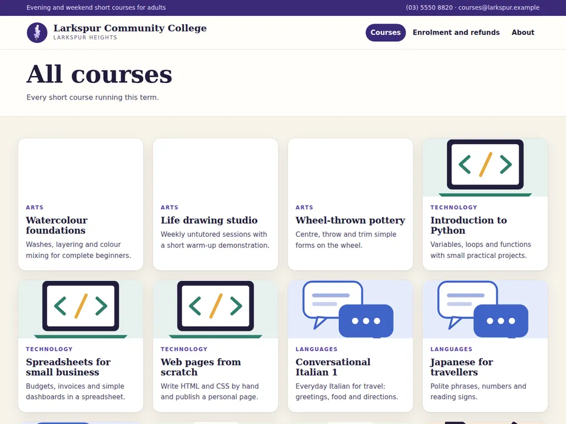
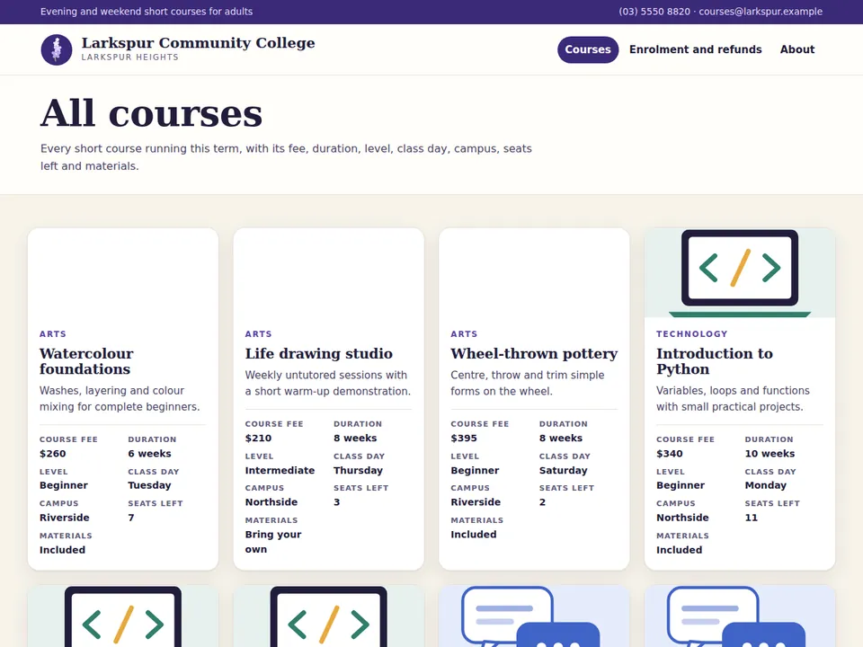

# Agent Readiness

**Usability testing for AI agents.** Agent Readiness sends real Meta Muse Spark browser agents to do customers' tasks on a website. It checks every answer against the site's own records, shows where the agents struggled and what to change, and then measures whether the change helped.

Built for the Meta Global AI Developer Hackathon 2026.

- **Demo video (official hackathon demo, 2:59):** https://www.youtube.com/watch?v=jWPLlQgWeS0
- **Live application:** https://209-38-84-72.sslip.io
- **Reference results (canonical paired evaluation):** [`#/reports/eval-1cf64d5e…`](https://209-38-84-72.sslip.io/#/reports/eval-1cf64d5eae90bcaeab531b4886140c14)
- **The workflow on a real example:** [the Larkspur journey](https://209-38-84-72.sslip.io/#/lifecycle)

## Why it matters

Websites are designed for people, but AI agents increasingly visit them on people's behalf. A site can be easy for a person and still be slow, costly or error-prone for an agent: a person glances at a page, while an agent pays a model request for every decision it makes. Analytics don't show this. The pages load, nothing throws an error, and the agent leaves with a partial answer or a guess. Agent Readiness makes the problem measurable and testable.

## What it does

- **Real agents, real tasks.** Fresh Muse Spark agents (Browser Use in Chromium) attempt customer questions written in customers' own words.
- **Independent grading.** Answers are checked against the site's own records, which the agent never sees. The agent's opinion of its own answer is ignored.
- **A readiness report.** For every agent it shows correctness, whether the agent saw the pages that hold the answer, navigation, reliability and cost. Each run can be replayed step by step with its screenshots and the agent's own working notes.
- **Evidence-linked recommendations.** Findings are measured page properties and recorded agent behaviour, each tied to the evidence behind it.
- **Before-and-after measurement.** The original and the changed website are evaluated with the same frozen tasks, agent and limits.
- **Safe to run in public.** Browsers are network-isolated, every model request is reserved against a spend cap before it is sent, and each run is settled at its actual cost.

## How it works

1. **Freeze the website.** A content-hashed snapshot of each website version is served to the agents from a read-only mirror.
2. **Generate and approve tasks.** Muse Spark proposes customer questions from the site and its business context. A code-only checker (no model) keeps a question only if the site really answers it, the answer is unique and can be graded, and the wording states everything the agent needs. The accepted set is reviewed, approved and frozen before any run.
3. **Evaluate live.** Each task goes to a fresh Muse Spark browser agent in a Chromium instance that can reach nothing but the frozen snapshot. Every page, screenshot, action and working note is recorded.
4. **Grade and diagnose.** Answers are graded against the records. Rule-based diagnostics (no model) combine page properties, such as which facts appear on listing pages, with the recorded agent behaviour, and turn them into specific recommendations.
5. **Improve and re-evaluate.** The website is changed according to the recommendations and evaluated again on the same frozen tasks. Both versions can run side by side in one paired evaluation.

## Demonstration: Larkspur Community College

Larkspur Community College is a fictional college with a freshly redesigned short-course catalogue. It looks good to people, but each course card shows only a name, a subject and a summary. The fee, duration, level, class day, campus, seats left and materials are one click deep, on each course's own page.

To answer *"List Beginner courses that meet on Saturday or Sunday"*, an agent on the **Original website** had to open course pages one at a time and ran out of requests before checking them all. Agent Readiness's report on the Original website recommended three changes: every fact on every course card, a fix for a "not found" dead end that an agent in an earlier evaluation hit by guessing a course address, and structured course data (schema.org JSON-LD). The **Agent-ready website** keeps the same design and pages with those changes applied. Its agents answered from the catalogue alone, without opening a single course page.

| Original website | Agent-ready website |
|---|---|
|  |  |

## Results

These come from the **canonical paired evaluation** [`eval-1cf64d5eae90bcaeab531b4886140c14`](https://209-38-84-72.sslip.io/#/reports/eval-1cf64d5eae90bcaeab531b4886140c14) (4 Nov 2026). Both websites were run in one live evaluation with the same three frozen tasks, model (`muse-spark-1.3`) and limits (14 model requests per agent).

| | Original website | Agent-ready website | Change |
|---|---|---|---|
| Correct answers | 0/3 | 3/3 | |
| Model requests, all tasks | 39 | 10 | 74% fewer |
| Agent time, all tasks | 326 s | 57 s | 83% less |
| Model cost | US$0.571 | US$0.134 | 77% less |
| Beginner weekend courses found (task 2) | 1/4 | 4/4 | |

These are the results of **one reference paired evaluation**, with one agent per task on each website. They are a measured result for these tasks, not a statistical guarantee, and individual live runs vary. Earlier separate runs of each website (one evaluation per version, 4 Nov 2026) are kept as historical records; their figures differ and are labelled as such in the application. Costs are calculated from provider-reported token usage. They are not invoices.

## Evaluate it

### The published evaluation (no login, no credentials)

The primary evidence is the recorded Muse Spark evaluation itself, published with its full provenance:

- **Canonical report:** [https://209-38-84-72.sslip.io/#/reports/eval-1cf64d5eae90bcaeab531b4886140c14](https://209-38-84-72.sslip.io/#/reports/eval-1cf64d5eae90bcaeab531b4886140c14). It covers results per agent and per task, recommendations with their evidence, navigation, reliability, cost, and the agent and model settings.
- **Agent replays:** [task 1](https://209-38-84-72.sslip.io/#/reports/eval-1cf64d5eae90bcaeab531b4886140c14/tasks/1) · [task 2](https://209-38-84-72.sslip.io/#/reports/eval-1cf64d5eae90bcaeab531b4886140c14/tasks/2) · [task 3](https://209-38-84-72.sslip.io/#/reports/eval-1cf64d5eae90bcaeab531b4886140c14/tasks/3). Each step's screenshot, action and the agent's own working notes, and its final answer, are shown for both websites side by side.
- **Raw traces and outputs (public JSON):**
  - `GET https://209-38-84-72.sslip.io/api/lifecycle/evaluations/eval-1cf64d5eae90bcaeab531b4886140c14`: the full report, with tasks, answers, grades, metrics and provenance.
  - `GET https://209-38-84-72.sslip.io/api/lifecycle/evaluations/eval-1cf64d5eae90bcaeab531b4886140c14/trials/<trial id>`: one agent's step-by-step trace (actions, goals, working memory, pages, screenshots). The trial ids are listed in the report, for example `polishedoriginal-gen-23f1802ee0-n-r1`.
- **In this repository:** [`dashboard/src/site/showcase/larkspur.json`](dashboard/src/site/showcase/larkspur.json) (key `paired`) is an exported copy of the canonical run's per-agent results and its weekend-task traces, with screenshots in `dashboard/src/site/showcase/frames/1cf6-*`.
- **Context:** the three-minute demonstration video, the [Larkspur journey](https://209-38-84-72.sslip.io/#/lifecycle) (the workflow step by step) and the Showcase of earlier recorded evaluations (labelled as historical).

The hosted Workspace shows running and completed evaluations to everyone. Starting a new live run there needs an operator access code, which is not distributed.

### Reproduce it yourself (optional)

Both paths run this repository's code on your machine after the [Development](#development) setup. **Neither reproduces the exact published Larkspur evaluation.** That run used the hosted service, a frozen task set approved and stored in the production data, and the redesigned Original and Agent-ready snapshots; rerunning it locally is not packaged in this version.

**1. The Larkspur pipeline at zero API cost (no key).**

```bash
.venv/bin/python -m agent_readiness.framework.evaluate larkspur --root runs/larkspur-dev --provider dev
```

It generates tasks from the frozen Larkspur snapshot, validates them independently and freezes them. It then runs every task in real Chromium on the site's two base versions (`original`, the earlier unstyled catalogue, and `modified`, its first fix), grades every answer against the course records and prints per-version totals. The trial records are written under `runs/larkspur-dev/<run id>/`. The agent is the scripted development provider, a loopback stand-in that is **not a model**, so this proves the pipeline rather than agent or website performance. In a clean checkout it ran 14 trials (7 generated tasks on each version) in about 4 minutes, with no key and no network request.

**2. A real Muse Spark agent with your own Meta Model API key (cost-capped).** Copy `.env.example` to `.env` and set `META_MODEL_API_KEY`, or export it in your shell; a shell variable takes precedence. Never commit `.env`. Then:

```bash
.venv/bin/readiness smoke --output runs           # credential-free preflight: a scripted navigator on the local demo storefront
.venv/bin/readiness probe --stage a --allow-model-calls      # one bounded request: checks your key, the endpoint and muse-spark-1.3
.venv/bin/readiness run --allow-model-calls --kind discovery --output runs \
  --max-model-requests 10 --max-estimated-cost-usd 0.05 --max-cumulative-estimated-cost-usd 0.50
```

`run` sends one fresh Muse Spark Browser Use agent to the **local demo storefront**: an offline electronics shop served on loopback, not Larkspur. The agent gets one shopping task, and its answer is graded independently against the shop's catalogue. Each request is checked before it is sent, and one whose worst-case estimated cost reaches the per-request cap, or would take the run's estimated total past the cumulative cap, is blocked. Each request's worst-case estimate is about US$0.03, so 10 requests stay under about US$0.31. The run also stops at 10 model requests, 10 steps or 120 seconds. Its record, trace and screenshots are written under `runs/`. These calls are charged to your key, and the costs shown are calculated estimates, not bills.

## Technical overview

```
Browser ──HTTPS──▶ Caddy ──▶ FastAPI service (hosted/, lifecycle/) ──▶ SQLite: admission, budget, settlement
                                 │  serves the React dashboard (dashboard/)
                                 ▼
                         evaluation worker (hosted/stageb.py)
                                 │  per agent: reserve spend ──▶ Meta Model API (Muse Spark)
                                 ▼
          network-isolated Chromium (hosted/jail.py) ──▶ read-only mirror of a frozen site snapshot (sites/larkspur/)
                                 │
                                 ▼
          recorded trace ──▶ graders (grading/) + diagnostics (diagnostics/) ──▶ readiness report (lifecycle/projection.py)
```

**Stack:** Meta Muse Spark via the Meta Model API (OpenAI-compatible), Browser Use, Playwright/Chromium, Python 3.12, FastAPI, SQLite, React 19 + TypeScript + Vite, Docker, Caddy, on a DigitalOcean VM.

| Component | Where |
|---|---|
| Hosted service: API, admission, budget and settlement, network-isolated browser, evaluation worker | [`src/agent_readiness/hosted/`](src/agent_readiness/hosted/) |
| Evaluation lifecycle: evaluations, reports, task-set review and freeze | [`src/agent_readiness/lifecycle/`](src/agent_readiness/lifecycle/) |
| Browser Use agent adapter (receives public task text only) | [`src/agent_readiness/agent.py`](src/agent_readiness/agent.py) |
| Task proposals and acceptance gate | [`src/agent_readiness/investigate/taskgen/`](src/agent_readiness/investigate/taskgen/), [`src/agent_readiness/taskeval/`](src/agent_readiness/taskeval/) |
| Answer graders (no model) | [`src/agent_readiness/grading/`](src/agent_readiness/grading/) |
| Diagnostics and recommendations (no model) | [`src/agent_readiness/diagnostics/`](src/agent_readiness/diagnostics/) |
| Larkspur website versions (frozen, hash-pinned snapshots) | [`src/agent_readiness/sites/larkspur/`](src/agent_readiness/sites/larkspur/): `polished_original.py` (Original website), `modified_polished.py` (Agent-ready website) |
| Spend safety: reserve-before-send ledger and per-request gate | [`src/agent_readiness/ledger.py`](src/agent_readiness/ledger.py), [`src/agent_readiness/spend_gate.py`](src/agent_readiness/spend_gate.py) |
| Web application (Home, journey, Workspace, reports, Showcase) | [`dashboard/src/site/`](dashboard/src/site/) |
| Container, reverse proxy, browser jail policy, deploy script | [`deploy/`](deploy/) |

## Repository structure

```
src/agent_readiness/   Python package: hosted service, lifecycle, agent, graders, diagnostics, site snapshots,
                       plus earlier research and experiment code (see docs/ARCHITECTURE.md)
dashboard/             React + TypeScript web application (dashboard/src/site/ is the public product)
tests/                 Python test suite (credential-free; loopback only)
datasets/              the recorded first Larkspur evaluation (datasets/lifecycle/m7-larkspur-browser-1), served by the product
deploy/                Dockerfile, compose, Caddyfile, jail and browser policies, deploy scripts
scripts/               test runners (dev-tests.sh, critical-tests.sh), showcase export and checks
docs/                  design, decision and submission documents (docs/README.md is the index)
collaboration/         task specifications, reports and handoffs: the project's dated engineering record
STATUS.md              current production state and history
```

## Development

Python 3.12 on Linux with [uv](https://docs.astral.sh/uv/), and Node 22 for the dashboard. The Python dependency set is pinned in `requirements.lock` (`uv.lock` is deliberately untracked).

```bash
uv venv --python 3.12
uv pip sync requirements.lock
uv pip install --no-deps --no-build-isolation -e .
.venv/bin/python -m playwright install --with-deps chromium
```

**Tests.** Every test is credential-free and loopback-only, and no test calls a model.

```bash
scripts/critical-tests.sh        # ~40 s: grants, ledger and spend gate, credentials, network isolation, cancellation, reports
scripts/dev-tests.sh             # ~2.5 min: all logic-level tests
cd dashboard && npm ci && npx tsc --noEmit -p . && npx vitest run && npm run build   # build ends with "CHECK PASSED"
```

CI ([`.github/workflows/`](.github/workflows/)) runs the complete Python suite, sharded, and the dashboard build and tests. See [docs/CI.md](docs/CI.md).

**Run the application locally (view-only).** After building the dashboard:

```bash
AR_HOSTED_MODE=disabled AR_HOSTED_DATA=/tmp/ar-data AR_STATIC_DIR=dashboard/dist AR_PORT=8765 \
  .venv/bin/python -m agent_readiness.hosted.serve
```

Then open http://127.0.0.1:8765. Home, the Showcase and the journey's recorded content render from data in the repository, and so does the recorded first Larkspur evaluation. The live evaluations, including the canonical paired run, are stored only in the production data volume and are not in the repository. New evaluations are disabled in this mode. Live mode needs a Meta Model API key (`META_MODEL_API_KEY`, see `.env.example`; never commit it), the Linux browser jail and owner authorisation, as described in [deploy/DEPLOY.md](deploy/DEPLOY.md).

## Limitations

- **Sample size.** One agent per task per website: the results are measured for these three tasks, not a statistical guarantee. Live runs of the same evaluation vary.
- **Browser agents.** Behaviour depends on the model, the Browser Use version and the request limit (14 per agent). A different agent configuration can struggle differently.
- **Controlled site.** Larkspur is a fictional site evaluated as a frozen snapshot in an isolated browser, not a live third-party website.
- **Recommendations** come from rule-based diagnostics over measured page properties and recorded behaviour. A person applies them; the product does not edit websites.
- **Not implemented.** A public benchmark and a discovery or capability registry for agent-ready websites are future concepts ([docs/FUTURE_ARCHITECTURE.md](docs/FUTURE_ARCHITECTURE.md)), not part of this product.

## Provenance

Hackathon implementation started on 2026-10-27 (Australia/Sydney). The earlier repository `Ezio99/Agent_Readiness` is a disclosed pre-event prototype; no executable source, tests, configuration or generated artifacts were copied from it. AI coding assistants helped build the project under the owner's direction. Meta integration evidence: [docs/META-INTEGRATION.md](docs/META-INTEGRATION.md). Contributor orientation: [COLD_START.md](COLD_START.md), [AGENTS.md](AGENTS.md).
